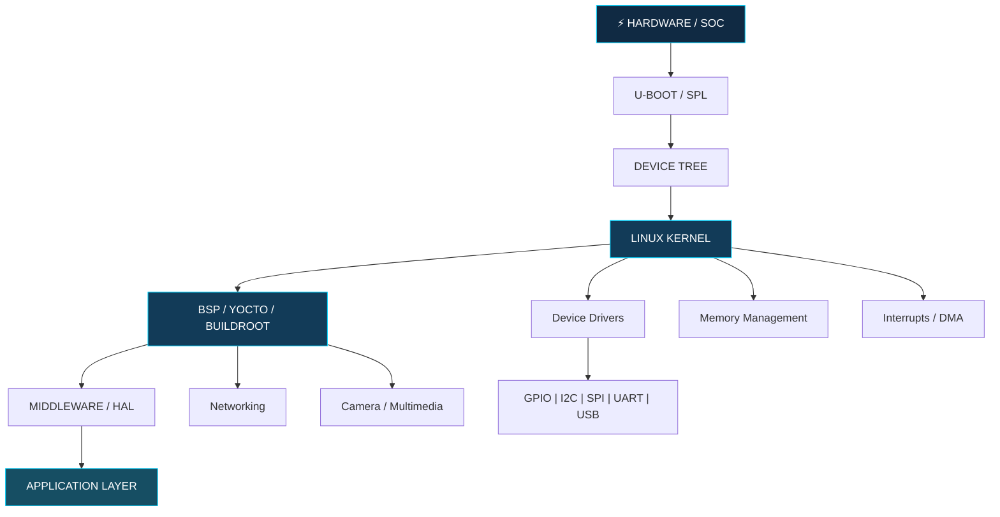

# ⚡ SEBASTIAN RAMESH

<div align="center">

### EMBEDDED SOFTWARE ENGINEER

**EMBEDDED LINUX • BSP DEVELOPMENT • LINUX KERNEL • DEVICE DRIVERS**

[](https://github.com/jsramesh1990)
[](https://www.linkedin.com/in/sebastian-ramesh-b84911327/)


**Engineering the bridge between hardware and software.**

</div>

---

## 🖥️ ENGINEERING PROFILE

```text
┌──────────────────────────────────────────────────────────────┐
│                  SYSTEM ENGINEERING PROFILE                  │
├──────────────────────────────────────────────────────────────┤
│                                                              │
│  ROLE       Embedded Software Engineer                       │
│  DOMAIN     Embedded Linux / BSP / Kernel                    │
│  FOCUS      Low-Level Systems & Hardware Integration         │
│  PLATFORMS  Qualcomm | NXP | Rockchip | STM32 | ESP32         │
│  LANGUAGES  C | C++ | Python | Bash                           │
│                                                              │
│  MISSION    Building reliable hardware-software systems      │
│                                                              │
└──────────────────────────────────────────────────────────────┘
```

I am an Embedded Software Engineer passionate about low-level software development, Linux internals, hardware integration and system-level debugging.

My engineering interests cover the complete embedded software stack:

- Bootloader development and board bring-up
- Linux kernel and device driver development
- BSP integration and embedded distributions
- Device Tree and peripheral configuration
- Ethernet and embedded networking
- Camera integration and multimedia pipelines
- Edge AI and hardware-accelerated applications

---

## ⚙️ TECHNOLOGY ECOSYSTEM

### Programming


### Embedded Linux & BSP


### Kernel & Device Drivers

`Linux Kernel` `Character Drivers` `Platform Drivers`

`Device Tree` `Interrupt Handling` `DMA`

`Memory Management` `GPIO` `I2C` `SPI` `UART` `USB`

### Networking & Ethernet


`MAC/PHY` `MDIO` `RGMII` `SGMII` `VLAN` `DHCP`

`UDP` `Socket Programming` `tcpdump` `iperf3`

### Camera & Multimedia

`V4L2` `MIPI CSI-2` `CamX` `ISP Integration`

`GStreamer` `Camera Sensor Integration`

### Hardware Platforms


### Development & Debugging

`Git` `GDB` `JTAG` `CMake` `Make` `Docker`

`Valgrind` `Kernel Debugging` `System Debugging`

`Performance Analysis` `GitHub Actions`

---

## 🧠 EMBEDDED LINUX — UNDER THE HOOD

**From silicon to software.**



---

## 🚀 FEATURED ENGINEERING PROJECTS

### 01 / QUALCOMM RB5 MULTI-CAMERA PLATFORM

**Embedded Camera & Multimedia Engineering**

`QUALCOMM RB5` `YOCTO` `LINUX KERNEL` `CAMX` `V4L2` `MIPI CSI-2`

- Camera sensor integration and configuration.
- Linux kernel camera driver integration.
- MIPI CSI-2 interface configuration.
- CamX camera pipeline integration.
- ISP configuration and camera validation.
- GStreamer-based camera streaming pipelines.
- End-to-end camera system debugging.

### 02 / ORANGE PI AI CCTV

**Edge AI & Computer Vision**

`ORANGE PI` `NPU` `PYTHON` `COMPUTER VISION`

- Real-time vision processing.
- Hardware-accelerated AI inference.
- Embedded computer vision applications.

[↗ EXPLORE PROJECT](https://github.com/jsramesh1990/Orange_Pi_AI_CCTV)

### 03 / RK3568 DDR MEMORY MANAGER

**Low-Level Memory Architecture**

`ROCKCHIP RK3568` `C` `DDR` `MEMORY MANAGEMENT`

- Low-level memory management exploration.
- DDR memory concepts.
- Embedded system memory architecture.

[↗ EXPLORE PROJECT](https://github.com/jsramesh1990/RK3568-DDR-Memory-Manager)

### 04 / STM32MP157 DISCOVERY

**Embedded Linux Platform Exploration**

`STM32MP1` `EMBEDDED LINUX` `C`

[↗ EXPLORE PROJECT](https://github.com/jsramesh1990/STM32MP157_Discovery)

### 05 / BEAGLEBONE BLACK

**Linux Kernel & Device Driver Exploration**

`BEAGLEBONE BLACK` `LINUX KERNEL` `DEVICE DRIVERS`

[↗ EXPLORE PROJECT](https://github.com/jsramesh1990/BeagleBone-Black)

### 06 / AQUARIUM TANK MONITORING

**IoT & Sensor Integration**

`ESP32` `C++` `IOT` `SENSORS`

[↗ EXPLORE PROJECT](https://github.com/jsramesh1990/Aquarium_Tank_Monitoring)

### 07 / SMARTLOCK PRO

**Embedded IoT Security System**

`ESP32` `C++` `IOT` `EMBEDDED SYSTEMS`

[↗ EXPLORE PROJECT](https://github.com/jsramesh1990/SmartLock-Pro_ESP32-IoT-Door-Lock-System)

---

## 📊 GITHUB ENGINEERING STATISTICS

<div align="center">


</div>

---

## 🔬 CURRENT ENGINEERING FOCUS

| Domain | Technical Exploration |
|---|---|
| Embedded Linux | Kernel, BSP, Boot Flow |
| Device Drivers | Character, Platform, Peripheral |
| Networking | Ethernet, TCP/IP, MAC/PHY |
| Camera Systems | V4L2, MIPI CSI-2, CamX |
| Edge AI | NPU, Inference, Optimization |
| Systems Programming | IPC, Multithreading, Synchronization |

### Learning & Exploration

`Rust for Embedded` `Zephyr RTOS` `Linux Internals`

`Automotive Ethernet` `NPU Optimization`

`Memory Management` `System Performance`

---

## 🎯 PROFESSIONAL INTERESTS

Interested in engineering opportunities involving:

- Embedded Software Engineering
- Embedded Linux & BSP Development
- Linux Kernel & Device Drivers
- Board Bring-up & Hardware Integration
- Android BSP & Qualcomm Platforms
- Ethernet & Automotive Networking
- Camera & Multimedia Systems
- Edge AI & Embedded Computing

---

<div align="center">

## 🤝 LET'S CONNECT

**Have an interesting embedded systems challenge? Let's talk engineering.**

[](https://github.com/jsramesh1990)
[](https://www.linkedin.com/in/sebastian-ramesh-b84911327/)

### "Building reliable embedded systems — from silicon to software."


</div>
