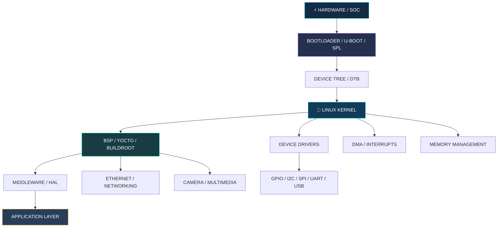

#  SEBASTIAN RAMESH

###  EMBEDDED SOFTWARE ENGINEER

**Embedded Linux | Linux Kernel | BSP | Device Drivers | Hardware Integration**

 

  

  

**"Engineering intelligent systems. Programming close to the hardware."**

---

##  ABOUT THE ENGINEER

I'm an **Embedded Software Engineer** passionate about low-level programming, embedded Linux architecture, hardware-software integration and system-level development.

My engineering interests span the complete embedded software stack — from **Bootloader and Board Bring-up to Linux Kernel, Device Drivers, BSP, Middleware and Applications**.

I enjoy exploring hardware internals, debugging complex system-level issues and developing efficient software for embedded platforms.

###  Engineering Domains

| Domain | Areas of Focus |
|:---|:---|
| 🐧 Embedded Linux | Linux Kernel, Yocto, Buildroot |
| 🔧 BSP Engineering | Board Bring-up, U-Boot, Device Tree |
| ⚙️ Kernel Development | Device Drivers, DMA, Interrupts |
| 🌐 Networking | Ethernet, TCP/IP, MAC/PHY |
| 📷 Camera Systems | V4L2, MIPI CSI-2, CamX, ISP |
| 🤖 Edge AI | NPU, Computer Vision, Inference |
| 🔌 Hardware | I2C, SPI, UART, USB, GPIO |

---

#  TECHNICAL ARSENAL

*Tools, technologies and platforms across the embedded ecosystem.*

###  Programming Languages

###  Embedded Linux & Operating Systems

###  Linux Kernel & Device Drivers

`GPIO` `I2C` `SPI` `UART` `USB` `V4L2` `Kernel Configuration`

###  Hardware & Embedded Platforms

###  Networking & Ethernet

`MAC/PHY` `MDIO` `RGMII` `SGMII` `VLAN` `Packet Debugging`

###  Camera & Multimedia Engineering

###  Development, Build & Debugging

---

#  EMBEDDED LINUX ARCHITECTURE

**From silicon to application layer**

---

#  FEATURED PROJECTS

*Engineering ideas translated into working embedded systems.*

###  01 — Qualcomm RB5 Multi-Camera Platform

- Camera sensor integration and configuration.
- Linux kernel camera driver integration.
- MIPI CSI-2 interface configuration.
- CamX camera pipeline integration.
- ISP configuration and camera validation.
- GStreamer-based camera streaming.
- End-to-end system debugging.

###  02 — Orange Pi AI CCTV

- Real-time vision processing.
- Hardware-accelerated AI inference.
- Embedded computer vision applications.

[🔗 VIEW SOURCE CODE](https://github.com/jsramesh1990/Orange_Pi_AI_CCTV)

###  03 — RK3568 DDR Memory Manager

- Low-level memory management exploration.
- DDR memory concepts.
- Embedded system memory architecture.

[🔗 VIEW SOURCE CODE](https://github.com/jsramesh1990/RK3568-DDR-Memory-Manager)

###  04 — STM32MP157 Discovery

[🔗 VIEW SOURCE CODE](https://github.com/jsramesh1990/STM32MP157_Discovery)

### 🔴 05 — BeagleBone Black

[🔗 VIEW SOURCE CODE](https://github.com/jsramesh1990/BeagleBone-Black)

### 🔵 06 — Aquarium Tank Monitoring

[🔗 VIEW SOURCE CODE](https://github.com/jsramesh1990/Aquarium_Tank_Monitoring)

### 🟣 07 — SmartLock Pro

[🔗 VIEW SOURCE CODE](https://github.com/jsramesh1990/SmartLock-Pro_ESP32-IoT-Door-Lock-System)

---

#  GITHUB ANALYTICS

###  GitHub Profile Trophies

### 📈 Statistics Dashboard

### 🔥 Contribution Streak

### 📅 Contribution Graph

---

# 🐍 CONTRIBUTION SNAKE

---

##  CURRENT TECHNICAL EXPLORATION

| Technology | Exploration |
|:---|:---|
| 🦀 Rust | Embedded & Linux Systems |
| ⚡ Zephyr RTOS | Real-Time Embedded Systems |
| 🐧 Kernel Internals | Linux Architecture |
| 🌐 Automotive Ethernet | Embedded Networking |
| 🤖 Edge AI | NPU Optimization |
| 🧠 Memory Systems | Low-Level Optimization |
| 🔧 Performance | Embedded System Profiling |

---

#  LET'S CONNECT

**Interested in Embedded Linux, Kernel Development, BSP Engineering and Hardware Integration?**

Let's exchange ideas and build something meaningful.

  

 

### ⚡ BUILDING RELIABLE EMBEDDED SYSTEMS
### FROM SILICON TO SOFTWARE.

